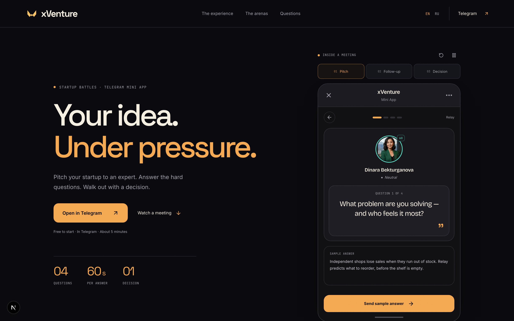
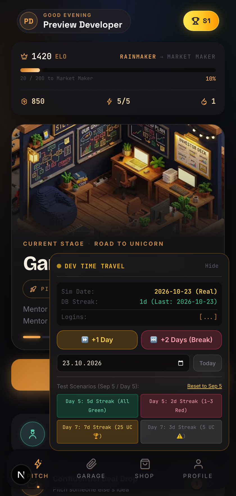
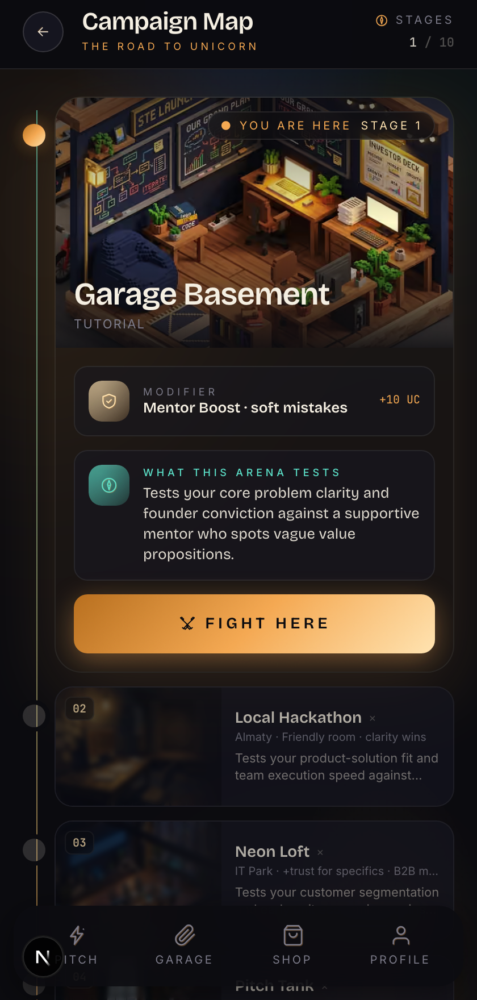
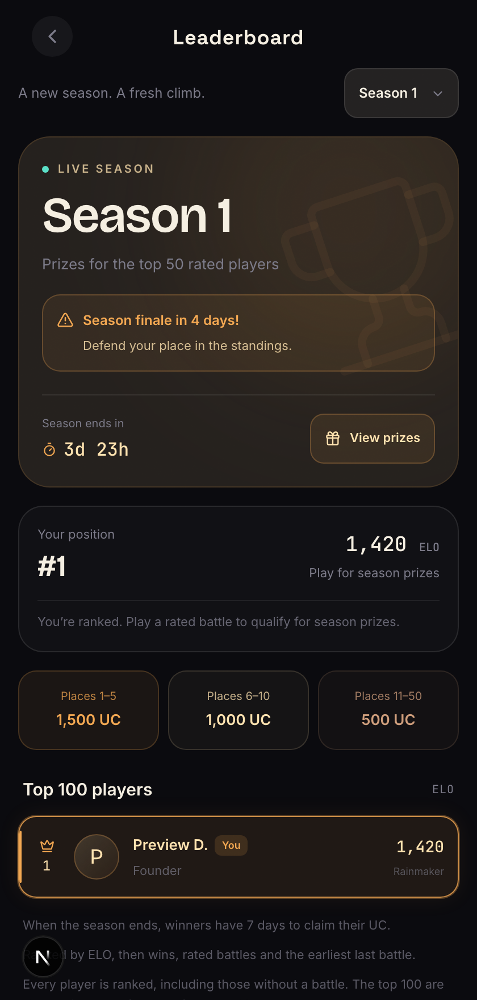
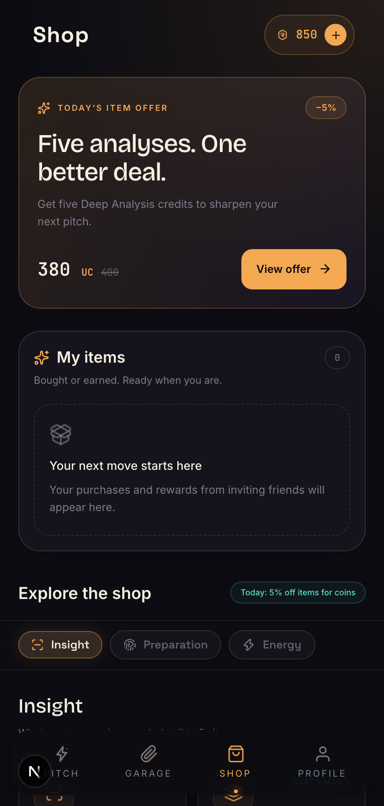
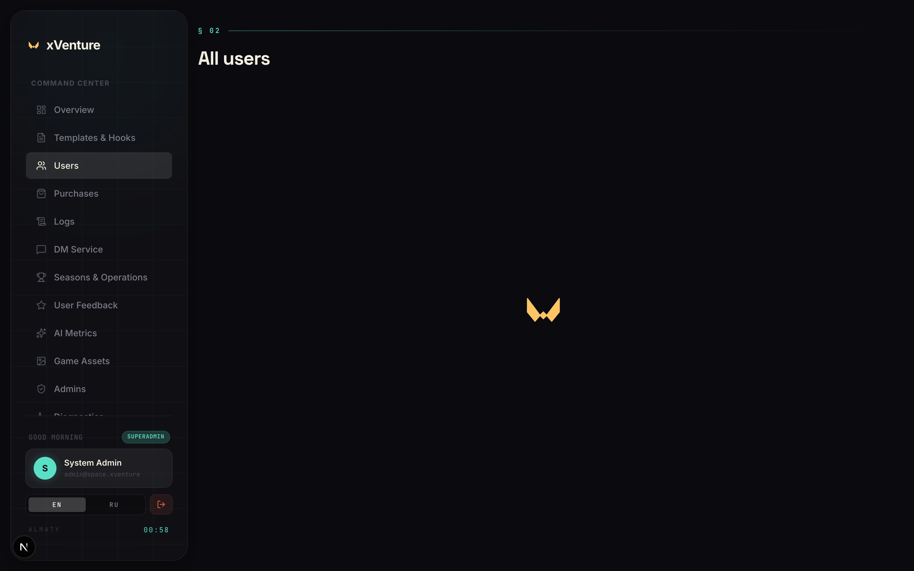

# 🚀 xVenture — AI Startup Pitch Simulator & Battle Arena

**CTO & Tech Lead** | `08.2026 — по настоящее время`  
Геймифицированная AI-платформа и Telegram Mini App для симуляции питчинга стартапов венчурным инвесторам с реальной экономикой, ELO-рейтингом и сезонными турнирами.

🔗 **Link:** [xventure.space](https://xventure.space) | 💻 **GitHub:** `Private Repository`

---

### 🛠 Технологии
* **Frontend & Client:** React 19, Next.js 15, TypeScript, Tailwind CSS, Framer Motion, Telegram Web App SDK, Lucide Icons, Sentry
* **Backend & Storage:** PostgreSQL, Drizzle ORM, Fastify, Next.js Server Components / Actions, REST API, i18n (KZ, RU, EN)
* **AI & LLM Core:** Multi-LLM оркестрация (Gemini API, Grok, OpenRouter), потоковая генерация вопросов инвестора, скоринг ответов и валидация питч-готовности
* **Инфраструктура & DevOps:** Docker Compose, GitLab CI/CD Quality Gates, автоматические cron-раннеры, Linear SDLC

---

### 🎯 Руководство и реализованный функционал
* **Инженерное лидерство:** Техническое руководство распределенной командой из 5 разработчиков, выстраивание процессов разработки через Linear + GitLab, проведение регулярных код-ревью и онбординг.
* **Архитектурный надзор:** Проектирование микросервисной экосистемы (`frontend`, `ai-service`, `dm-service`), разделение песочниц и production-репозиториев.
* **AI-симулятор питчинга:** Интерактивные сессии с инвестиционным комитетом — 4 вопроса под ограничением времени, анализ сильных и слабых сторон стартапа, расчет инвестиционного чека и генерация детального отчета.
* **Честная рейтинговая система (Fair ELO):** Математическая модель динамического ELO, предотвращение Pay-to-Win манипуляций (изоляция ELO от покупок за реальные деньги), автоматические сезоны и призовые пулы.
* **Игровая экономика:** Механики ежедневного Deal Drop, регенерация энергии фаундера, инвентарь бустов, система страйков и магазин ресурсов.
* **Административная консоль:** Разработка полнофункционального портала с ролевым доступом (RBAC), управлением сезонами, аудитом матчей и мониторингом состояния платформы.
* **CI/CD Quality Gates:** Внедрение автоматизированного тестирования бизнес-критичной логики (сезонный ролловер, транзакции инвентаря, паритет локализации).

---

### 💻 Интерфейс

#### 1. Десктопный лендинг платформы (Landing Page)
Презентация продукта для инвесторов, фаундеров и партнеров с описанием механики и интеграцией Telegram.

  

#### 2. Главный экран фаундера (Telegram Mini App Home)
Энергия, баланс монет, активный стартап, текущий ELO и ежедневный Deal Drop инвесторов.

  

#### 3. Арены питчинга и уровни инвесторов (Pitch Arenas)
Прогрессия основателя от закрытого бункера до единорожьего клуба с возрастающей сложностью вопросов.

  

#### 4. Сезонный лидерборд и рейтинги (Fair ELO Rankings)
Таблица лидеров сезона с прозрачной системой начисления очков и призовыми местами.

  

#### 5. Игровая экономика и магазин (Founder Shop & Inventory)
Покупка расходных материалов, бустеров энергии и глубоких аналитических отчетов по питчу.

  

#### 6. Панель управления и администрирования (Admin Portal)
Единый центр мониторинга платформы, телеметрии сезонов, управления пользователями и финансового аудита.

  

