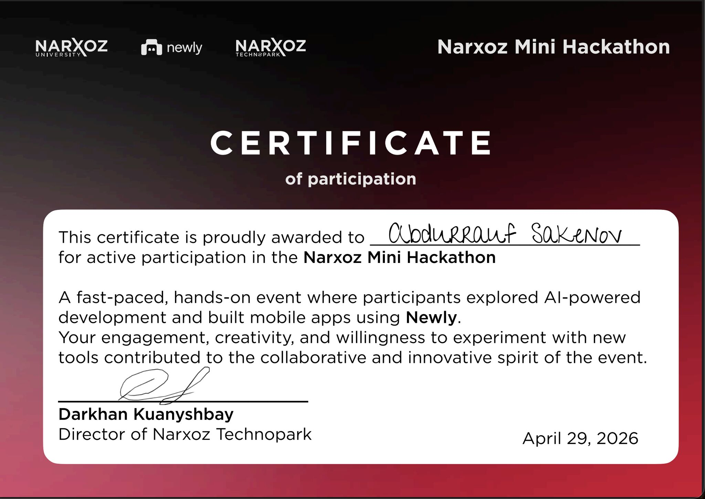

**Сәкенов Абдуррауф Саматұлы**

Возраст: 21 год (23.07.2005) 
**Локация & Формат: Алматы | Фуллтайм офис, гибрид, стажировка, удаленка** 
Контакты: +7 (776) 004 41 05 | [t.me/defiveninth](https://t.me/defiveninth) | abdurrauf.sakenov@proton.me 
Языки: Казахский (родной), Русский (свободный), Английский (В1) 
Желаемая ЗП: от 400 000 KZT 
**Желаемая Должность: бекенд разработчик, фронтенд разработчик, разработчик мобильных приложений, Vibe Coder** 
Образование: Университет Нархоз, 4 курс, специальность «IT, Digital Engineer» (**неоконченное высшее**) год окончание 2027

**Опыт работы** 
TeqserTeam | Мобильный разработчик | React Native | Стартап команда 
*01.2026 — 05.2026 (Кибербезопасность, инкубатор NURIS)*

Ybirai Education | Frontend-разработчик 
*12.2023 — 06.2024 (EdTech-стартап)*

Narxoz AI Studio | Frontend-разработчик | Next JS 
*02.2023 — 10.2023 (Цифровизация physical-очередей вуза)*

**Про меня**
* **Креативность и продуктовое видение:** Всегда анализирую текущее состояние проекта и передлагаю идеи для его дальнейшего развития.
* **Критическое мышление:** Нацелен на конечный результат; просчитываю долгосрочные последствия принимаемых решений и возможные риски.
* **Problem Solving (Решение проблем):** Эффективно решаю сложные задачи через глубокое понимание сути проблемы, обсуждение и фокус на нужном результате.
* **Командная работа и коммуникация:** Профессионально веду деловые обсуждения, эффективно взаимодействую внутри команды и нацелен на общий успех.
* **Высокая отзывчивость (Responsiveness):** Всегда на связи, оперативно реагирую на рабочие запросы и не игнорирую сообщения в чатах.
* **Стрессоустойчивость:** Уверенно работаю в условиях высокой многозадачности и плотного потока задач.
* **Организованность и продуктивность:** Умею эффективно выстраивать свой рабочий процесс для достижения максимальной производительности.

**Технические навыки** 
Языки программирования 
* **Глубокое знание:** JavaScript (ES6+), TypeScript, Swift, HTML5, CSS3
* **Базовый опыт:** Python, Java, MQL5

 Backend-разработка 
* **Фреймворки:** NestJS, Fastify, Express, FastAPI (Python)
* **ORM / Database Tools:** Prisma, TypeORM
* **Базы данных:** PostgreSQL, MySQL, SQLite, JSONDB, Redis

 Архитектура & Аутентификация 
* **Протоколы и подходы:** RESTful APIs, GraphQL, WebSockets (real-time), MVC, Microservices, HTTP/HTTPS
* **Авторизация:** JWT, NextAuth, Session-based auth, Интеграция сторонних провайдеров (OAuth / 3rd party)

 Frontend Web 
* **Фреймворки:** React, Next.js (App / Pages Router), Vue
* **Стилизация & UI:** Tailwind CSS, shadcn/ui, Ant Design, Figma
* **Управление состоянием:** React Context API, Redux
* **Инструменты & Деплой:** React Hook Form, lucide-react, react-icons, i18n (мультиязычность), Vercel

 Мобильная разработка 
* **Технологии:** React Native (Expo), SwiftUI (iOS native)
* **Компоненты & UI:** Верстка экранов любой сложности, темная/светлая темы (Theme Switcher), анимации
* **Функционал:** Интеграция Native API (геолокация, camera), мультиязычность (i18n), обработка push-уведомлений
* **Клиент-сервер:** Синхронизация данных через HTTP, GraphQL и WebSockets

 AI Инструменты & Автоматизация (AI-Driven Development) 
* **Среды разработки & Ассистенты:** Cursor, Claude Code, GitHub Copilot, Codex, OpenCode, Antigravity
* **Интеграция моделей (LLM API):** Работа и автоматизация процессов на базе Gemini 3.1/3.5, QWEN, ChatGPT, Claude
* **Локальный ИИ:** Развертывание и использование моделей через Ollama
* **Скрипты:** Написание Python/JS скриптов для парсинга данных, автоматического заполнения баз данных и имитации действий пользователей

 DevOps & Инструменты 
* **Контроль версий:** Git, GitHub, GitLab
* **Пакетные менеджеры:** npm, yarn, pnpm
* **Контейнеризация:** Docker
* **Окружение:** macOS (MacBook)

**Проекты (через ссылку можно увидеть скриншоты, код, или пробовать)** 
Веб сайты 
* [Электронная очередь Нархоз](./projects/e-queue/readme.md) — Screenshots Production Link Next.js
* [Tekser Landing](./projects/tekser-landing/readme.md) — Screenshots Production Link Next.js
* [Mizucare](./projects/mizu-care/readme.md) — Screenshots Source Code Production Link Next.js Gemini AI
* [Smart Parking](./projects/smart-parking/readme.md) — Screenshots Source Code Next.js
* [SenseLab](./projects/senselab/readme.md) — Screenshots Source Code NextJs Gemini AI
* [Nextgen blogpost](./projects/nextgen-blogpost/readme.md) — Screenshots Source Code NextJs PSQL
* [TakeQuiz](https://github.com/defiveninth/quiz-app-front/blob/master/README.md) — Screenshots Source Code NextJS

 Мобильные приложений 
* [Tekser](./projects/tekser/readme.md) — Screenshots React Native Gemini AI
* [Wagwan](./projects/wagwan/readme.md) — Screenshots React Native
* [Book Table](https://github.com/defiveninth/book-table/blob/main/readme.md) — Screenshots Source Code Swift

 Серверный приложений 
* [Book Table Server](https://github.com/defiveninth/book-table/blob/main/rrs-server/README.md) — Source Code Documentation ExpressJS SQLite
* [Smart Parking Server](https://github.com/dilfuza00/parking-app/blob/main/server/README.md) — Source Code Documentation ExpressJS SQLite
* [TakeQuiz Server](https://github.com/defiveninth/quiz-app-back/blob/new-branch/README.md) — Source Code Documentation Nestjs SMTP Prisma PSQL

 Terminal, script 
* [Smart Parking AI CV](./projects/parking-count/readme.md) — Screenshots Source Code YOLO openCV Python

**Жизненный активность:**

Тестировал проект [Mizucare](#) на реальных пользователей:
  
 
Интерес к технологию блокчейн, криптовалюты и торговля на бирже, ивенте от Bybit Kazakhstan, нетворкинг:
  
 
Участие в ABC incubation, прошли до финал:
  
 
Участие в хакатон Halyk Oyi Tech III:
  
 
Участие в MUIT стартап питчинг в качестве спикера, помогал участникам составит свой презентаций перед инвесторами:
  
 
Участие в евенте Freedom: Who on-cvwill be in demand tomorrow:
  
 
Участие в мини хакатон от newly AI:
 